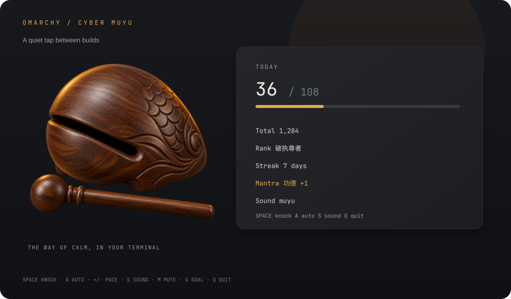

# Cyber Muyu · 赛博木鱼

<p align="center">
  <strong><a href="README.md">English</a></strong> | <a href="README.zh-CN.md">简体中文</a>
</p>

<p align="center">
  
</p>

<p align="center">
  <a href="https://plugins.omarchy.org"></a>
  <a href="https://hyprland.org"></a>
  <a href="https://sw.kovidgoyal.net/kitty/graphics-protocol/"></a>
  <a href="https://python.org"></a>
  <a href="LICENSE"></a>
</p>

Tap an electronic wooden fish directly from your Wayland status bar or terminal, hear a gentle wooden click, accumulate cyber merit, and find inner peace between compile runs and debugging sessions.

---

## ✨ Features

### 🪷 Zen Animation & Aesthetics
- **Procedural Canvas 2D Graphics**: Smoothly rendered wooden fish body, striker mallet, and acoustic soundwaves.
- **Dynamic Physics & Shockwaves**: Satisfying squashing, elastic bouncing, and radial shockwave ripples triggered on every strike.
- **Floating Karma Mantras**: Visual toasts drift upward with each tap (`功德 +1`, `Bug -1`, `头发 +1`, or custom mantras).
- **Adaptive System Theming**: Palette automatically harmonizes with the active Omarchy bar theme and system accents.

### 🎧 Anti-Fatigue Audio
- **4 Studio Soundscapes**: Bundled authentic wooden fish (`muyu`), Tibetan singing bowl (`bowl`), tranquil water bubble (`bubble`), and clicky mechanical switch (`click`).
- **Pitch & Volume Micro-Detune**: Subtle randomized micro-pitch and volume perturbations prevent auditory fatigue during long sessions.
- **Configurable Auto-Knocking**: Relax and let the wooden fish knock automatically from 30 to 180 BPM.

### 🖥️ Dual-Mode Architecture
- **Wayland Bar Widget**: Lightweight QML plugin for the Omarchy status bar with a comprehensive popup practice panel.
- **Terminal TUI Client**: Full-featured standalone interactive terminal client (`cyber_muyu.py`) featuring Kitty Graphics protocol, 24-bit ANSI TrueColor half-blocks, and Unicode art fallback.
- **Thread & Process Safe**: POSIX file advisory locks (`fcntl.flock`) serialize state updates seamlessly across bar widget, hotkeys, and CLI processes.

### 📈 Coder Karma & Progression
- **5 Programmer Ranks**: Level up your digital soul from *Novice Monk* (`扫地码农`) to *Cyber Buddha* (`赛博斗战胜佛`).
- **Daily Goals & Streaks**: Set your daily merit aspiration (default: 108) with visual progress bars and consecutive day streak tracking.
- **7-Day Trend History**: Track your mindfulness habits with a 7-day rolling merit history.

### ⌨️ Global IPC & Hyprland Hotkeys
- **Omarchy Shell IPC**: Full headless control over knocking, toggling the panel, and switching auto-knocking mode.
- **Hyprland Native Bindings**: Strike the fish anytime with global hotkeys without leaving your editor.

---

## 🚀 Quickstart

### Option A: Omarchy Bar Widget

Install and enable the widget through the Omarchy CLI:

```bash
omarchy plugin add https://github.com/chivopic/omarchy-cyber-muyu.git --enable
```

Or install manually into your user plugins directory:

```bash
mkdir -p ~/.config/omarchy/plugins
git clone https://github.com/chivopic/omarchy-cyber-muyu.git ~/.config/omarchy/plugins/io.github.chivopic.cyber-muyu
omarchy plugin enable io.github.chivopic.cyber-muyu right
```

#### Bar Widget Controls

| Action | Result |
| :--- | :--- |
| **Left-click** bar widget | Strike once, play sound, increment merit (+1) |
| **Right-click** bar widget | Toggle the Zen practice panel |
| **Middle-click** bar widget | Start or pause automatic knocking |
| **Click wooden fish** in panel | Strike with animated mallet bounce and floating mantra |

---

### Option B: Standalone Terminal Client

No Omarchy required! Run `cyber_muyu.py` directly from any terminal:

```bash
git clone https://github.com/chivopic/omarchy-cyber-muyu.git
cd omarchy-cyber-muyu
./cyber_muyu.py
```

<p align="center">
  
</p>

The client auto-detects your terminal environment:
- **Kitty Graphics protocol** in Kitty, Ghostty, and WezTerm.
- **24-bit ANSI TrueColor** half-block graphics in truecolor-capable terminals.
- **Unicode / ASCII** line drawing fallback for basic terminals or SSH sessions.

#### Terminal Keybindings

| Key | Action | Description |
| :---: | :--- | :--- |
| <kbd>Space</kbd> / <kbd>Enter</kbd> / <kbd>K</kbd> | **Knock** | Strike wooden fish once, play sound, increment merit |
| <kbd>A</kbd> | **Toggle Auto** | Start or pause automatic knocking |
| <kbd>+</kbd> / <kbd>-</kbd> | **Adjust Pace** | Increase or decrease pace by 5 BPM (30–180 BPM) |
| <kbd>S</kbd> | **Cycle Sound** | Switch between `muyu`, `bowl`, `bubble`, and `click` |
| <kbd>M</kbd> | **Mute / Unmute** | Toggle strike sound volume |
| <kbd>G</kbd> | **Set Daily Goal** | Change your daily target (1–99,999) |
| <kbd>Q</kbd> / <kbd>Ctrl+C</kbd> | **Quit** | Exit the terminal application |

#### Terminal CLI Options

```text
usage: cyber_muyu.py [-h] [--renderer {auto,kitty,ansi,unicode,ascii}]
                     [--image-width IMAGE_WIDTH] [--silent] [--status]
                     [--plain] [--json] [--knock [MANTRA]]

Options:
  --renderer {auto,kitty,ansi,unicode,ascii}
                        Art rendering mode (default: auto)
  --image-width N       Width of rendered artwork in columns (16–52, default: 44)
  --silent              Disable strike audio playback
  --status              Print compact one-line status summary and exit
  --plain, --no-emoji   Omit emoji icons in status output
  --json                Output full backend summary JSON and exit
  --knock [MANTRA]      Strike once non-interactively with optional custom mantra
```

---

## 🍳 Cookbook & Integrations

### 1. Git Post-Commit Hook: Automated Karma on Commit

Accumulate merits and dispel bugs with every commit! Create `.git/hooks/post-commit` in your repository (or configure globally via `core.hooksPath`):

```bash
#!/usr/bin/env bash
# .git/hooks/post-commit - Strike the wooden fish on git commit

# Strike via Omarchy IPC if running, otherwise use standalone CLI
if command -v omarchy >/dev/null 2>&1 && omarchy shell ipc io.github.chivopic.cyber-muyu knock "Commit +1" >/dev/null 2>&1; then
    exit 0
fi

# Fallback: standalone terminal script
CLIENT_PATH="$HOME/.config/omarchy/plugins/io.github.chivopic.cyber-muyu/cyber_muyu.py"
if [ -x "$CLIENT_PATH" ]; then
    "$CLIENT_PATH" --knock "Commit +1" >/dev/null 2>&1 || true
fi
```

Make the hook executable:

```bash
chmod +x .git/hooks/post-commit
```

Every `git commit` will now trigger a strike sound and increment your daily merit counter.

---

### 2. Statusline & Shell Prompt Integration

Display your live daily merits and programmer rank right in your shell prompt or multiplexer status bar.

#### Tmux Statusline

Add this to `~/.tmux.conf`:

```tmux
# Update status every 30 seconds
set -g status-interval 30

# Show Cyber Muyu merits in right status bar
set -g status-right "#(python3 ~/.config/omarchy/plugins/io.github.chivopic.cyber-muyu/cyber_muyu.py --status) | %H:%M "
```

Output:
```text
🪷 42 功德 · 破执尊者 | 15:30
```

#### Starship Prompt

Add a custom command in `~/.config/starship.toml`:

```toml
[custom.cyber_muyu]
command = "python3 ~/.config/omarchy/plugins/io.github.chivopic.cyber-muyu/cyber_muyu.py --status"
when = "true"
format = "[$output]($style) "
style = "bold #e8ab53"
```

#### Bash / Zsh Prompt

Add to `~/.bashrc` or `~/.zshrc`:

```bash
# Add Cyber Muyu status to prompt
muyu_prompt() {
    python3 ~/.config/omarchy/plugins/io.github.chivopic.cyber-muyu/cyber_muyu.py --status 2>/dev/null
}

# Example for Zsh:
RPROMPT='$(muyu_prompt)'
```

---

### 3. Hyprland Keybinding Recipes

Bind global hotkeys in `~/.config/hypr/hyprland.conf` to knock, open the practice panel, or toggle auto-knocking without leaving your code:

```ini
# Super + M: Knock wooden fish once (+1 merit)
bind = $mainMod, M, exec, omarchy shell ipc io.github.chivopic.cyber-muyu knock

# Super + Shift + M: Toggle the Zen practice panel
bind = $mainMod SHIFT, M, exec, omarchy shell ipc io.github.chivopic.cyber-muyu toggle

# Super + Alt + M: Start / pause automatic knocking
bind = $mainMod ALT, M, exec, omarchy shell ipc io.github.chivopic.cyber-muyu toggleAuto
```

---

## ⚙️ Settings Reference

Settings can be changed from the graphical practice panel, the terminal client, or Omarchy plugin preferences. All state is preserved across reboots in `~/.local/state/omarchy/cyber-muyu/data.json`.

| Setting | Default | Range / Options | Description |
| :--- | :---: | :--- | :--- |
| `showCount` | `true` | `true`, `false` | Display today's merit count next to the lotus icon on the bar. |
| `sound` | `"muyu"` | `muyu`, `bowl`, `bubble`, `click` | Audio sample played on strikes. |
| `volume` | `80` | `0` – `100` (%) | Strike audio playback volume (`0` is muted). |
| `mantra` | `"功德 +1"` | 6 presets or custom text (up to 32 chars) | Floating mantra displayed when knocking (`功德 +1`, `Bug -1`, `头发 +1`, `薪水 +1`, `编译通过`, `顺利下班`). |
| `autoBpm` | `60` | `30` – `180` (BPM) | Tempo for automatic knocking rhythm. |
| `dailyGoal` | `108` | `1` – `99,999` | Daily merit target for streak tracking and progress bar visualization. |

*Note: Automatic knocking state is session-bound and does not persist across shell restarts.*

---

## 🥋 Programmer Ranks

Accumulate merits over time to elevate your coder karma through 5 contemplative ranks:

| Rank | English Title | Min Merits | Zen Developer Quote | Description |
| :--- | :--- | :---: | :--- | :--- |
| **扫地码农** | Novice Monk | 0+ | 身如菩提树，心如明镜台 | Beginning the journey of mindful development. |
| **闭关罗汉** | Meditating Arhat | 100+ | 一行行代码，一声声木鱼 | Focused concentration; distractions begin to fade. |
| **破执尊者** | Bug-Free Venerable | 500+ | 心无挂碍，无挂碍故，无有Bug | Overcoming attachments to flawed logic; clean compiles. |
| **代码菩萨** | Code Bodhisattva | 2,000+ | 度一切苦厄，普度CI/CD | Compassionate architecture, patient reviews, saving broken builds. |
| **赛博斗战胜佛** | Cyber Buddha | 10,000+ | 跳出三界外，不在五行中 | Supreme digital enlightenment; zero segfaults, infinite peace. |

---

## 🔧 Troubleshooting & FAQ

### Q: Why do I hear no sound when knocking?
1. **Audio Player**: `cyber_muyu.py` looks for `pw-play` (PipeWire) or `paplay` (PulseAudio). Ensure `pipewire-audio` or `pulseaudio-utils` is installed on your distribution.
2. **Volume Setting**: Ensure volume is not muted (`volume > 0`). In the terminal client, press <kbd>M</kbd> to unmute. In the bar panel, drag the volume slider upward.
3. **Headless / Silent Environments**: You can intentionally disable audio using `--silent`.

### Q: Why is terminal art distorted or falling back to Unicode?
1. **Kitty Graphics Protocol**: Requires Kitty, Ghostty, or WezTerm. Inside Tmux or Screen, multiplexer image passthrough might be disabled; the client automatically falls back to ANSI truecolor in that case.
2. **TrueColor Support**: Half-block rendering (`--renderer ansi`) requires a 24-bit TrueColor terminal. Check if `COLORTERM=truecolor` is exported.
3. **Force a Mode**: You can override autodetection at any time:
   ```bash
   ./cyber_muyu.py --renderer unicode
   ```

### Q: How do the bar widget and terminal client synchronize?
State is unified in `~/.local/state/omarchy/cyber-muyu/data.json`. Concurrency between the QML bar widget, global Hyprland hotkeys, and terminal sessions is guarded by an exclusive POSIX advisory lock (`fcntl.flock`). Updates are atomic and race-free.

---

## 🗑️ Uninstallation

To remove the Omarchy plugin:

```bash
omarchy plugin remove io.github.chivopic.cyber-muyu --yes
```

To clean up persistent merit data:

```bash
rm -rf ~/.local/state/omarchy/cyber-muyu ~/.config/cyber-muyu
```

---

## 📄 License

Distributed under the [MIT License](LICENSE). Contributions, bug reports, and pull requests are welcome!
